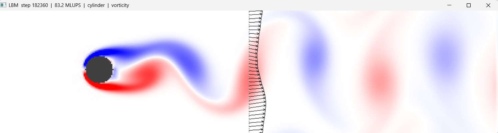
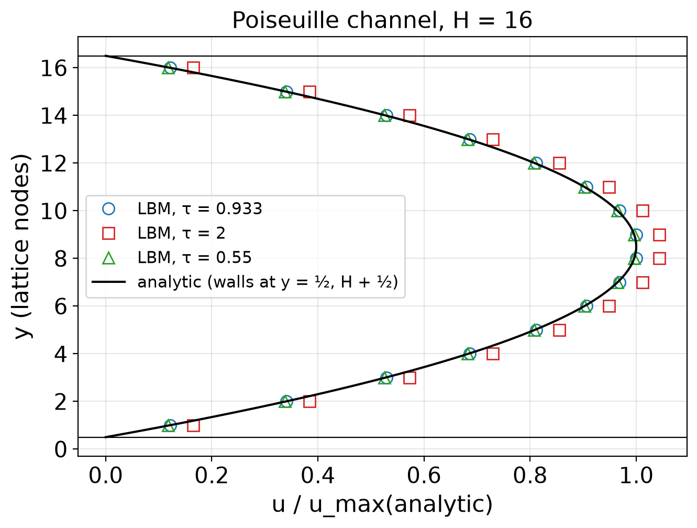
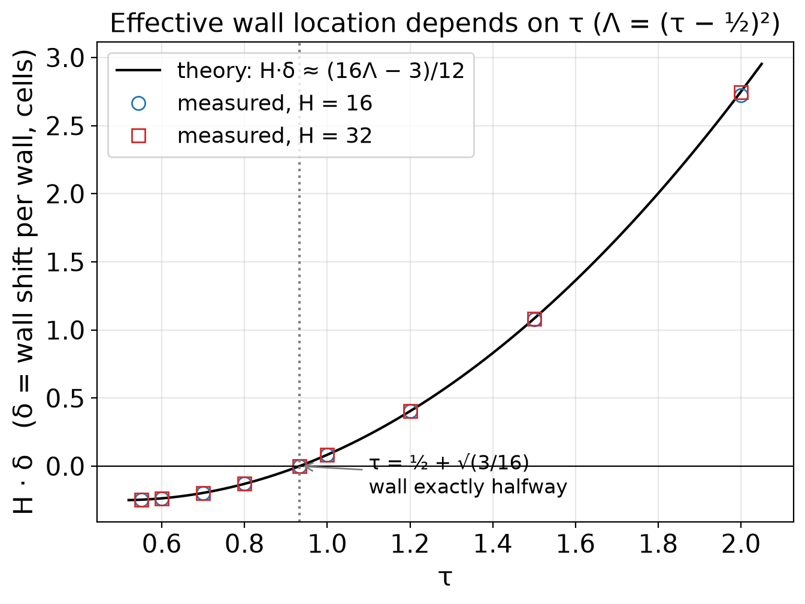
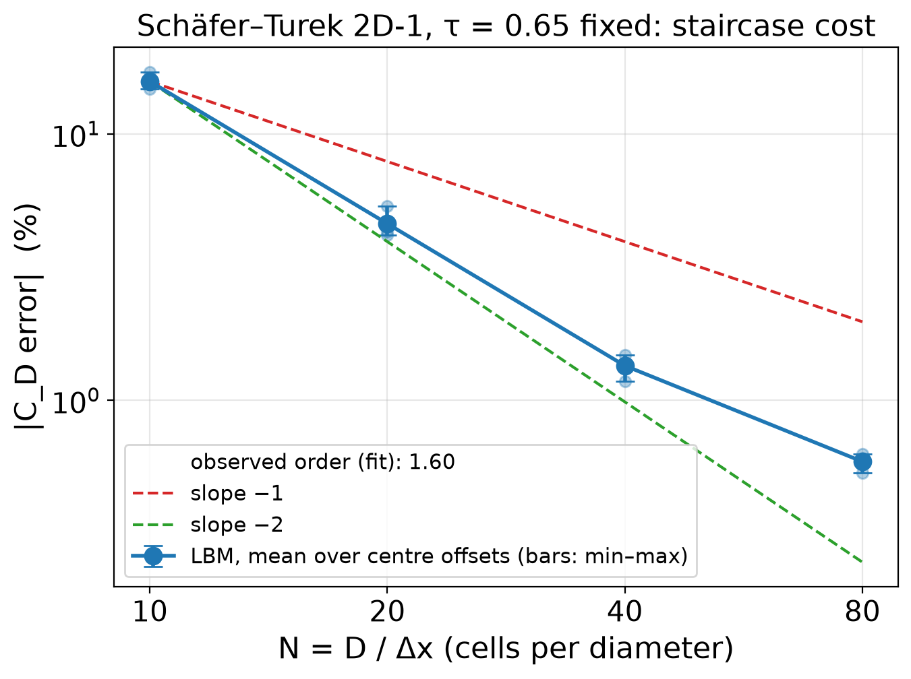

# Lattice Boltzmann Fluid Solver (D2Q9, BGK, CPU + CUDA)

A 2D lattice Boltzmann method (LBM) fluid solver in C++, with a CUDA port and a live OpenGL viewer.
It started as a way to explore my interests in statistical mechanics, computational physics and
high-performance C++. It became the project for my talk at the IVC/Saddleback Student Research Symposium (Nov 6, 2026):

**From Particle Collisions to Navier–Stokes: Accuracy and Performance of a Lattice Boltzmann Solver**



## What it does

Instead of solving the Navier–Stokes equations directly, LBM stores at each grid node nine particle
populations `f_i` (D2Q9: rest, 4 axis and 4 diagonal directions). Every time step:

1. **moments:** `rho = Σ f_i`, `rho u = Σ f_i c_i`
2. **equilibrium:** a discretised Maxwell–Boltzmann distribution `f_i^eq(rho, u)`
3. **collide (BGK):** `f_i ← f_i − (f_i − f_i^eq) / tau`
4. **stream:** `f_i(x + c_i, t + 1) = f_i(x, t)`

The Chapman–Enskog expansion shows that this recovers Navier–Stokes at low Mach number, with viscosity
`nu = (tau − 1/2) / 3` (lattice units). I keep the lattice speed `u ≤ 0.1` (Ma ≈ 0.17), because the
compressibility error grows like Ma².

Features:
- halfway bounce-back walls
- Guo body forcing
- two inlet/outlet options: an equilibrium inlet with a zero-gradient outlet, or a non-equilibrium-extrapolation
  velocity inlet with a pressure outlet
- forces on bodies by momentum exchange
- OpenMP on the CPU
- a fused stream–collide CUDA kernel (float or double) that matches the CPU to round-off

## Research questions

1. Does D2Q9 BGK reproduce known flows? Tested on Poiseuille channel flow (exact solution), vortex
   shedding behind a cylinder (experiments) and the Schäfer–Turek 2D-1 benchmark (drag).
2. How much accuracy does staircase bounce-back cost on a curved wall? Tested with a grid convergence
   study of the drag at fixed `tau`, which needs the GPU.

## Results

### Poiseuille flow (`sweep_poiseuille_tau`, `check_poiseuille`)
- The steady profile is an exact parabola (fit residual ~1e-14), and its L2 error converges at order **2.000** for H = 4…64.
- The viscosity measured from the curvature matches `(tau − 1/2)/3` to **~1e-11** for every tau from 0.55 to 2.0.
- The walls are not exactly halfway: the effective channel width follows
  `H_eff² = H² + (16Λ − 3)/3`, `Λ = (tau − 1/2)²` (He et al. 1997) to every printed digit.
  At tau = 2 and H = 16, each wall sits 0.17 cells too far out. Only at the "magic" tau = 1/2 + √(3/16) ≈ 0.933
  is the wall exactly halfway, and there the error is round-off (~1e-13).
- At steady state, the wall force equals the body force to 1e-12.




### Vortex shedding (`run_strouhal`, GPU)
D = 40 cells in a 1600 × 800 domain (5% blockage), U = 0.1. St comes from the lift signal, by FFT and zero crossings.

| Re | St (LBM) | Williamson | difference |
|---|---|---|---|
| 50 | 0.1292 | 0.1231 | +5.0% |
| 75 | 0.1535 | 0.1492 | +2.9% |
| 100 | 0.1683 | 0.1643 | +2.4% |
| 125 | 0.1790 | 0.1750 | +2.3% |
| 150 | 0.1871 | 0.1834 | +2.0% |

Every point is a few percent high, by a similar amount. That fits the remaining 5% blockage and Ma = 0.17, both of which push St up.

My earlier 400 × 100 domain (22% blockage) gave St = 0.20 at Re = 100, 23% high. Confinement matters.

### Schäfer–Turek 2D-1, Re = 20 (`run_schafer_turek`, GPU, tau = 0.65 fixed)
C_D is the mean over 3 sub-cell positions of the cylinder centre. The reference is C_D = 5.57954.

| N (cells per diameter) | C_D | error |
|---|---|---|
| 10 | 6.459 ± 0.068 | +15.8% |
| 20 | 5.836 ± 0.036 | +4.6% |
| 40 | 5.655 ± 0.009 | +1.35% |
| 80 | 5.612 ± 0.003 | +0.59% |

- The observed order is ≈ 1.8 from N = 10 to 40, better than the first order expected for a staircase. From 40 to 80 it
  flattens to ≈ 1.2.
- Richardson extrapolation of the last three N gives order ≈ 2.1 and C_D → 5.599, which is still 0.36% above the reference.
  So a small error remains that grid refinement does not remove. The inlet/outlet treatment or the finite domain are the
  first suspects (not yet tested).
- For 1% drag accuracy with staircase bounce-back, you need ~50 cells per diameter.
- The tiny lift is dominated by the staircase: shifting the centre by 0.2 cells makes the rasterised cylinder
  lopsided and changes C_L by up to ~20× at N = 10, while C_D moves only 1–2%. By N = 80 every placement gives
  1.0–1.8× the reference lift.



### Performance (`check_gpu`, RTX 4050 Laptop, 192 GB/s peak)

| grid | GPU float | GPU double | CPU double (all cores) |
|---|---|---|---|
| 1024² | 2018 MLUPS (145 GB/s) | 707 MLUPS (102 GB/s) | 37 MLUPS |
| 4096² | 1741 MLUPS (125 GB/s) | 699 MLUPS (101 GB/s) | – |

- Double on the GPU is about 19× faster than the CPU.
- Float reaches 65–88% of the peak DRAM bandwidth on large grids. Results above 100% on small grids come from
  the grid fitting in the L2 cache.
- Double tops out at ~52% because this GeForce card runs FP64 at 1/64 rate.

## Repository layout

| path | what |
|---|---|
| `src/lbm_core.h` | CPU solver: `Lattice`, boundary conditions, forces, test cases (`SchaferTurek`, channel, flow past a body) |
| `src/lbm_gpu.cuh` | CUDA port: `LatticeGPU<T>` built from a CPU `Lattice` |
| `src/lbm_viewer.cpp`, `src/viewer_gl.cu` | CPU viewer and live CUDA + OpenGL viewer |
| `tests/check_*.cpp`, `tests/check_gpu.cu` | pass/fail validation checks |
| `tests/sweep_poiseuille_tau.cpp`, `tests/run_*.cu` | data-producing runs; write CSVs to `runs/` |
| `scripts/make_figures.py` | regenerates every figure in `figures/` and `figures/tables.md` from `runs/` |

## Building and running

All commands run from the repo root.

**CPU** (MSYS2 UCRT64 g++):
```
g++ -O3 -march=native -fopenmp tests/check_poiseuille.cpp -o check_poiseuille.exe
g++ -O3 -march=native -fopenmp tests/sweep_poiseuille_tau.cpp -o sweep_poiseuille_tau.exe
```
The same command pattern builds `check_cylinder` and `check_schafer_turek`.

**GPU** (CUDA 13.1 + Visual Studio 2022 Build Tools; `build_gpu.bat` sets up MSVC, then runs `nvcc -arch=sm_89`):
```
.\build_gpu.bat                              # tests\check_gpu.cu -> check_gpu.exe
.\build_gpu.bat tests\run_strouhal.cu        # -> run_strouhal.exe
.\build_gpu.bat tests\run_schafer_turek.cu   # -> run_schafer_turek.exe
.\build_viewer_gl.bat                        # live viewer
```

**Reproducing the results:**
```
.\sweep_poiseuille_tau.exe            # ~25 s
.\run_schafer_turek.exe 10 20 40      # ~6 min
.\run_schafer_turek.exe 80            # 0.93 M steps per offset: ~15 min each at full speed, much longer if the laptop throttles
.\run_strouhal.exe                    # ~30 min, double, Re 50-150
python scripts/make_figures.py        # needs numpy + matplotlib
```
Every CSV starts with `#` lines recording the parameters and the git hash it was made with.

## References
- Krüger, T. et al. (2017). *The Lattice Boltzmann Method: Principles and Practice.* Springer.
- Qian, Y. H., d'Humières, D., & Lallemand, P. (1992). Lattice BGK models for Navier–Stokes equation. *Europhys. Lett.* 17(6), 479–484.
- He, X., Zou, Q., Luo, L.-S., & Dembo, M. (1997). Analytic solutions of simple flows and analysis of nonslip boundary conditions for the lattice Boltzmann BGK model. *J. Stat. Phys.* 87, 115–136.
- Schäfer, M., & Turek, S. (1996). Benchmark computations of laminar flow around a cylinder. In *Flow Simulation with High-Performance Computers II*, 547–566.
- Williamson, C. H. K. (1996). Vortex dynamics in the cylinder wake. *Annu. Rev. Fluid Mech.* 28, 477–539.
- Roshko, A. (1954). On the development of turbulent wakes from vortex streets. NACA Report 1191.

Brian Storey's video on Poiseuille flow is a very clear walkthrough of the analytic solution, and I highly recommend it: [Brian Storey's video](https://www.youtube.com/watch?v=zsp6ZNB62mc). He doesn't know me or anything, I just thought he made a great video :P
